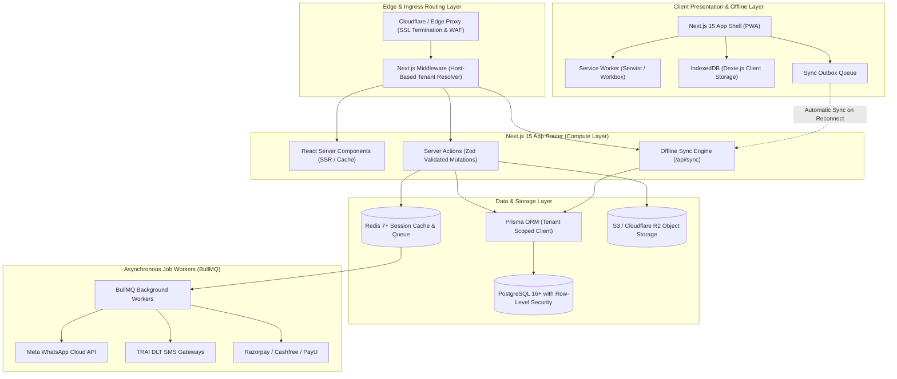

# System Architecture Specification: Multi-Tenant, Offline-First Education ERP

This document specifies the end-to-end technical architecture, component topologies, data flow patterns, and integration boundaries for the platform.

---

## 1. High-Level Architectural Topology



---

## 2. Multi-Tenancy & Host Resolution Engine

### 2.1 Host-Based Resolution Pattern
Multi-tenancy is completely dynamic and host-driven. The system resolves tenants using the following resolution precedence:
1. **Platform Root / Super Admin**:
   - Host matches `app.edusaas.com` or `localhost:3000`.
   - Injects `x-is-super-admin: "true"`.
   - Rewrites internally to `/(super-admin)/*` route group.
2. **Tenant Subdomain**:
   - Host matches `{slug}.edusaas.com` (e.g. `dpsdelhi.edusaas.com`).
   - Looks up tenant in fast in-memory / Redis cache (`tenant:slug:{slug}`).
   - Injects `x-tenant-id`, `x-tenant-slug`, `x-tenant-type`.
   - Rewrites internally to `/(tenant)/[tenant]/*` route group.
3. **Custom Verified CNAME**:
   - Host matches third-party domain (e.g. `erp.stmarysacademy.in`).
   - Queries Redis cache (`tenant:domain:erp.stmarysacademy.in`).
   - Verifies SSL status and injects corresponding tenant context.

### 2.2 Middleware Implementation Details
```typescript
// middleware.ts
import { NextRequest, NextResponse } from 'next/server';

export async function middleware(req: NextRequest) {
  const hostname = req.headers.get('host') || '';
  const url = req.nextUrl;

  // 1. Static asset bypass
  if (url.pathname.startsWith('/_next') || url.pathname.includes('.')) {
    return NextResponse.next();
  }

  // 2. Resolve Host
  const isSuperAdmin = hostname === process.env.NEXT_PUBLIC_APP_DOMAIN || hostname === 'localhost:3000';
  
  if (isSuperAdmin && url.pathname.startsWith('/admin')) {
    return NextResponse.rewrite(new URL(`/super-admin${url.pathname}`, req.url));
  }

  // 3. Resolve Tenant Subdomain or Custom Domain
  const tenant = await resolveTenantFromHost(hostname);
  if (!tenant) {
    return NextResponse.rewrite(new URL('/404-tenant-not-found', req.url));
  }

  const response = NextResponse.rewrite(new URL(`/${tenant.slug}${url.pathname}`, req.url));
  response.headers.set('x-tenant-id', tenant.id);
  response.headers.set('x-tenant-slug', tenant.slug);
  response.headers.set('x-tenant-theme', JSON.stringify(tenant.themeConfig));
  return response;
}
```

---

## 3. Database Isolation Strategy: PostgreSQL RLS + Prisma Client Extension

We utilize a **Shared Database with Logical Row-Level Security (RLS)** reinforced by application-level Prisma Client extensions.

### 3.1 Why Shared DB + RLS?
- **Operational Cost**: Running 500+ separate database instances for budget schools is financially non-viable.
- **Resource Pooling**: Connection pooling with PgBouncer allows thousands of idle tenant users without resource exhaustion.
- **Instant Tenant Provisioning**: Creating a new school takes **200 milliseconds** (insert 1 row into `tenants`) instead of running 20-minute database migration pipelines.
- **Zero-Risk Isolation**: Even if a developer writes `prisma.student.findMany()` without a `where` clause, the PostgreSQL kernel rejects cross-tenant data through RLS policies.

### 3.2 Prisma Tenant-Scoped Extension
```typescript
// lib/prisma.ts
import { PrismaClient } from '@prisma/client';

export const prisma = new PrismaClient();

export function getTenantPrisma(tenantId: string) {
  return prisma.$extends({
    query: {
      $allModels: {
        async $allOperations({ model, operation, args, query }) {
          // Automatic tenant_id injection on mutations
          if (['create', 'createMany'].includes(operation)) {
            if (args.data) {
              if (Array.isArray(args.data)) {
                args.data = args.data.map(item => ({ ...item, tenant_id: tenantId }));
              } else {
                args.data = { ...args.data, tenant_id: tenantId };
              }
            }
          }
          // Automatic tenant_id scoping on queries
          if (['findMany', 'findFirst', 'findUnique', 'count', 'update', 'delete'].includes(operation)) {
            args.where = { ...args.where, tenant_id: tenantId };
          }
          return query(args);
        },
      },
    },
  });
}
```

---

## 4. True Offline-First Architecture & Synchronization Engine

### 4.1 Client-Side Database Schema (Dexie.js)
```typescript
// lib/offline/db.ts
import Dexie, { Table } from 'dexie';

export interface LocalStudent {
  id: string;
  admission_no: string;
  name: string;
  class_id: string;
  section_id: string;
  roll_no: number;
  sync_status: 'synced' | 'pending';
}

export interface SyncOutboxItem {
  id: string; // Client UUID
  endpoint: string;
  method: 'POST' | 'PUT' | 'DELETE';
  payload: any;
  created_at: number;
  retry_count: number;
}

export class OfflineERPDatabase extends Dexie {
  students!: Table<LocalStudent, string>;
  sync_outbox!: Table<SyncOutboxItem, string>;

  constructor() {
    super('EduERP_OfflineDB');
    this.version(1).stores({
      students: 'id, admission_no, class_id, section_id, sync_status',
      sync_outbox: 'id, endpoint, created_at, retry_count'
    });
  }
}

export const offlineDb = new OfflineERPDatabase();
```

### 4.2 Outbox Processing Algorithm
1. Mutation occurs (e.g. Roll Call marked).
2. Write directly to `offlineDb.students` (immediate optimistic UI update).
3. Insert record into `offlineDb.sync_outbox`.
4. Online event listener triggers `processOutbox()`:
   ```typescript
   export async function processOutbox() {
     if (!navigator.onLine) return;
     const items = await offlineDb.sync_outbox.orderBy('created_at').toArray();
     
     for (const item of items) {
       try {
         const res = await fetch(item.endpoint, {
           method: item.method,
           headers: { 'Content-Type': 'application/json', 'x-idempotency-key': item.id },
           body: JSON.stringify(item.payload),
         });
         if (res.ok) {
           await offlineDb.sync_outbox.delete(item.id);
         } else if (res.status >= 400 && res.status < 500) {
           // Client error (unresolvable): log and remove to prevent queue blocking
           console.error('Fatal mutation error:', await res.text());
           await offlineDb.sync_outbox.delete(item.id);
         }
       } catch (err) {
         console.warn('Network sync interrupted, will retry:', err);
         break; // Stop iteration; wait for next network pulse
       }
     }
   }
   ```

---

## 5. Security & Authentication Architecture

- **Session Protocol**: NextAuth.js v5 using JWT strategy stored in secure, `httpOnly`, `SameSite=Lax` cookies.
- **Multi-Role Payload**: The JWT contains:
  ```json
  {
    "sub": "user_uuid",
    "tenant_id": "tenant_uuid",
    "role": "TEACHER",
    "permissions": ["attendance:create", "marks:edit", "timetable:read"],
    "allowed_sections": ["sec_10a_uuid", "sec_10b_uuid"]
  }
  ```
- **Tenant Tampering Prevention**: The `tenant_id` from the host header is strictly validated against the user's JWT `tenant_id`. Cross-tenant URL tampering immediately invalidates the session and returns 403 Forbidden.

---

## 6. Asynchronous Jobs & Messaging Topologies

Heavy institutional workloads are offloaded to Redis-backed BullMQ workers:
1. **Parent WhatsApp / SMS Dispatch Queue**:
   - Concurrency: 50 workers.
   - Handles rate-limiting per Meta and TRAI DLT guidelines (e.g. max 30 msgs/second per sender ID).
2. **Report Card PDF Generation Queue**:
   - Concurrency: 10 worker processes running Headless Chrome / `@react-pdf/renderer`.
   - Compiles 500 report cards into a single ZIP file and uploads to S3, returning a signed download URL to the Principal.
3. **Automated Fee Defaulter Cron**:
   - Runs daily at 8:00 AM UTC.
   - Evaluates unpaid invoices past grace periods and schedules WhatsApp payment reminder links.
