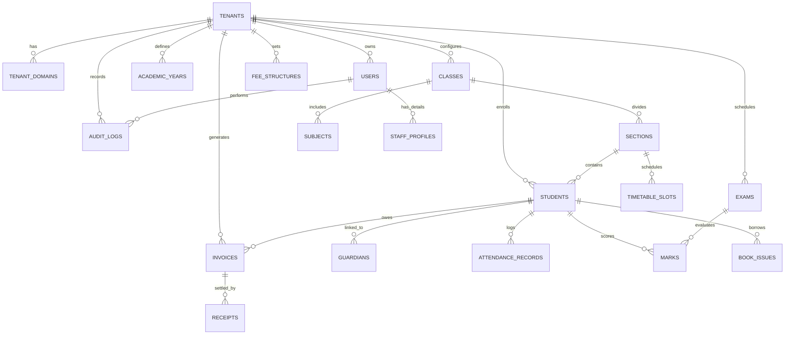

# Database Schema, Entity Relationship Diagram (ERD) & RLS Policies

This document defines the complete relational database architecture for PostgreSQL 16+ managed via Prisma ORM, with full Row-Level Security (RLS) definitions.

---

## 1. High-Level Entity Relationship Diagram (Mermaid)



---

## 2. Core Relational Schema Specification (Prisma Definition)

```prisma
datasource db {
  provider = "postgresql"
  url      = env("DATABASE_URL")
}

generator client {
  provider = "prisma-client-js"
}

// ==========================================
// 1. TENANTS & SUBSCRIPTIONS
// ==========================================

enum TenantType {
  K12_SCHOOL
  DEGREE_COLLEGE
  UNIVERSITY
  COACHING_ACADEMY
}

enum SubscriptionStatus {
  TRIAL
  ACTIVE
  PAST_DUE
  SUSPENDED
  CANCELLED
}

model Tenant {
  id              String             @id @default(uuid()) @db.Uuid
  name            String             @db.VarChar(255)
  slug            String             @unique @db.VarChar(63) // Subdomain: {slug}.edusaas.com
  type            TenantType         @default(K12_SCHOOL)
  status          SubscriptionStatus @default(TRIAL)
  plan_tier       String             @default("STARTER") @db.VarChar(50)
  max_students    Int                @default(500)
  
  // Custom Branding Configuration
  logo_url        String?            @db.Text
  favicon_url     String?            @db.Text
  primary_color   String             @default("#4F46E5") @db.VarChar(7)
  secondary_color String             @default("#0F172A") @db.VarChar(7)
  font_family     String             @default("Plus Jakarta Sans") @db.VarChar(50)
  custom_domain   String?            @unique @db.VarChar(255)
  domain_verified Boolean            @default(false)
  
  // Enabled User Portals & Features
  enable_students Boolean            @default(true)
  enable_parents  Boolean            @default(true)
  feature_flags   Json               @default("{}") // 500+ modular feature toggles
  
  // Statutory Data
  udise_code      String?            @db.VarChar(20)
  aishe_code      String?            @db.VarChar(20)
  affiliation_no  String?            @db.VarChar(50)
  gstin           String?            @db.VarChar(15)
  currency        String             @default("INR") @db.VarChar(3)
  timezone        String             @default("Asia/Kolkata") @db.VarChar(50)

  created_at      DateTime           @default(now())
  updated_at      DateTime           @updatedAt

  domains         TenantDomain[]
  users           User[]
  academic_years  AcademicYear[]
  classes         Class[]
  students        Student[]
  fee_structures  FeeStructure[]
  invoices        Invoice[]
  receipts        Receipt[]
  exams           Exam[]
  audit_logs      AuditLog[]

  @@map("tenants")
}

model TenantDomain {
  id          String   @id @default(uuid()) @db.Uuid
  tenant_id   String   @db.Uuid
  domain      String   @unique @db.VarChar(255)
  is_verified Boolean  @default(false)
  ssl_status  String   @default("PENDING") @db.VarChar(50)
  created_at  DateTime @default(now())

  tenant      Tenant   @relation(fields: [tenant_id], references: [id], onDelete: Cascade)

  @@index([tenant_id])
  @@map("tenant_domains")
}

// ==========================================
// 2. USERS, ROLES & AUDIT
// ==========================================

enum UserRole {
  SUPER_ADMIN
  ADMIN
  TEACHER
  ACCOUNTANT
  LIBRARIAN
  TRANSPORT_HEAD
  HOSTEL_WARDEN
  STUDENT
  PARENT
}

model User {
  id            String    @id @default(uuid()) @db.Uuid
  tenant_id     String?   @db.Uuid // Nullable ONLY for platform Super Admin
  email         String    @db.VarChar(255)
  phone         String?   @db.VarChar(20)
  password_hash String    @db.Text
  role          UserRole  @default(STUDENT)
  first_name    String    @db.VarChar(100)
  last_name     String    @db.VarChar(100)
  is_active     Boolean   @default(true)
  last_login_at DateTime?
  created_at    DateTime  @default(now())
  updated_at    DateTime  @updatedAt

  tenant        Tenant?   @relation(fields: [tenant_id], references: [id], onDelete: Cascade)
  audit_logs    AuditLog[]

  @@unique([tenant_id, email])
  @@index([tenant_id, role])
  @@map("users")
}

model AuditLog {
  id         String   @id @default(uuid()) @db.Uuid
  tenant_id  String?  @db.Uuid
  user_id    String?  @db.Uuid
  action     String   @db.VarChar(100) // e.g. "STUDENT_MARKS_UPDATE"
  entity     String   @db.VarChar(100) // e.g. "Mark"
  entity_id  String   @db.VarChar(100)
  old_values Json?
  new_values Json?
  ip_address String?  @db.VarChar(45)
  user_agent String?  @db.Text
  created_at DateTime @default(now())

  tenant     Tenant?  @relation(fields: [tenant_id], references: [id], onDelete: Cascade)
  user       User?    @relation(fields: [user_id], references: [id], onDelete: SetNull)

  @@index([tenant_id, entity, entity_id])
  @@index([created_at])
  @@map("audit_logs")
}

// ==========================================
// 3. ACADEMIC STRUCTURE
// ==========================================

model AcademicYear {
  id         String   @id @default(uuid()) @db.Uuid
  tenant_id  String   @db.Uuid
  title      String   @db.VarChar(100) // e.g. "2026-2027"
  start_date DateTime @db.Date
  end_date   DateTime @db.Date
  is_current Boolean  @default(false)
  created_at DateTime @default(now())

  tenant     Tenant   @relation(fields: [tenant_id], references: [id], onDelete: Cascade)
  classes    Class[]

  @@unique([tenant_id, title])
  @@map("academic_years")
}

model Class {
  id               String       @id @default(uuid()) @db.Uuid
  tenant_id        String       @db.Uuid
  academic_year_id String       @db.Uuid
  name             String       @db.VarChar(100) // e.g. "Class 10" or "B.Tech CSE"
  numeric_level    Int          @default(1)
  created_at       DateTime     @default(now())

  tenant           Tenant       @relation(fields: [tenant_id], references: [id], onDelete: Cascade)
  academic_year    AcademicYear @relation(fields: [academic_year_id], references: [id], onDelete: Cascade)
  sections         Section[]
  subjects         Subject[]

  @@index([tenant_id, academic_year_id])
  @@map("classes")
}

model Section {
  id         String    @id @default(uuid()) @db.Uuid
  tenant_id  String    @db.Uuid
  class_id   String    @db.Uuid
  name       String    @db.VarChar(50) // e.g. "Section A" or "Div 1"
  capacity   Int       @default(40)
  created_at DateTime  @default(now())

  class      Class     @relation(fields: [class_id], references: [id], onDelete: Cascade)
  students   Student[]

  @@index([tenant_id, class_id])
  @@map("sections")
}

model Subject {
  id         String   @id @default(uuid()) @db.Uuid
  tenant_id  String   @db.Uuid
  class_id   String   @db.Uuid
  name       String   @db.VarChar(150) // e.g. "Mathematics"
  code       String?  @db.VarChar(50)  // e.g. "MATH-041"
  is_theory  Boolean  @default(true)
  is_lab     Boolean  @default(false)
  credits    Float    @default(4.0)
  created_at DateTime @default(now())

  class      Class    @relation(fields: [class_id], references: [id], onDelete: Cascade)

  @@index([tenant_id, class_id])
  @@map("subjects")
}

// ==========================================
// 4. STUDENTS & GUARDIANS
// ==========================================

enum Gender {
  MALE
  FEMALE
  OTHER
}

model Student {
  id             String    @id @default(uuid()) @db.Uuid
  tenant_id      String    @db.Uuid
  section_id     String    @db.Uuid
  admission_no   String    @db.VarChar(100)
  roll_no        Int?
  prn            String?   @db.VarChar(100) // University Permanent Registration Number
  apaar_id       String?   @db.VarChar(12)  // Indian APAAR / ABC ID
  first_name     String    @db.VarChar(100)
  last_name      String    @db.VarChar(100)
  dob            DateTime  @db.Date
  gender         Gender    @default(MALE)
  blood_group    String?   @db.VarChar(5)
  category       String    @default("GENERAL") @db.VarChar(20) // GEN, OBC, SC, ST, EWS
  is_rte_quota   Boolean   @default(false)
  photo_url      String?   @db.Text
  emergency_phone String?  @db.VarChar(20)
  is_active      Boolean   @default(true)
  created_at     DateTime  @default(now())
  updated_at     DateTime  @updatedAt

  tenant         Tenant    @relation(fields: [tenant_id], references: [id], onDelete: Cascade)
  section        Section   @relation(fields: [section_id], references: [id], onDelete: Restrict)
  invoices       Invoice[]
  receipts       Receipt[]
  marks          Mark[]

  @@unique([tenant_id, admission_no])
  @@index([tenant_id, section_id])
  @@index([tenant_id, roll_no])
  @@map("students")
}

// ==========================================
// 5. FEES, BILLING & RECEIPTS
// ==========================================

model FeeStructure {
  id          String   @id @default(uuid()) @db.Uuid
  tenant_id   String   @db.Uuid
  title       String   @db.VarChar(150) // e.g. "Class 10 Annual Fees 2026-27"
  total_fee   Decimal  @db.Decimal(12, 2)
  created_at  DateTime @default(now())

  tenant      Tenant   @relation(fields: [tenant_id], references: [id], onDelete: Cascade)

  @@index([tenant_id])
  @@map("fee_structures")
}

enum InvoiceStatus {
  PENDING
  PARTIAL
  PAID
  CANCELLED
}

model Invoice {
  id          String        @id @default(uuid()) @db.Uuid
  tenant_id   String        @db.Uuid
  student_id  String        @db.Uuid
  invoice_no  String        @db.VarChar(100)
  title       String        @db.VarChar(200) // e.g. "Term 1 Tuition Fee"
  amount      Decimal       @db.Decimal(12, 2)
  paid_amount Decimal       @default(0.00) @db.Decimal(12, 2)
  due_date    DateTime      @db.Date
  status      InvoiceStatus @default(PENDING)
  created_at  DateTime      @default(now())
  updated_at  DateTime      @updatedAt

  tenant      Tenant        @relation(fields: [tenant_id], references: [id], onDelete: Cascade)
  student     Student       @relation(fields: [student_id], references: [id], onDelete: Cascade)
  receipts    Receipt[]

  @@unique([tenant_id, invoice_no])
  @@index([tenant_id, student_id, status])
  @@map("invoices")
}

enum PaymentMethod {
  CASH
  UPI_QR
  CARD_POS
  ONLINE_GATEWAY
  BANK_TRANSFER
  CHEQUE
}

model Receipt {
  id             String        @id @default(uuid()) @db.Uuid
  tenant_id      String        @db.Uuid
  invoice_id     String        @db.Uuid
  student_id     String        @db.Uuid
  receipt_no     String        @db.VarChar(100)
  amount         Decimal       @db.Decimal(12, 2)
  payment_method PaymentMethod @default(CASH)
  transaction_ref String?      @db.VarChar(150)
  collected_by   String?       @db.Uuid // User ID of cashier
  notes          String?       @db.Text
  created_at     DateTime      @default(now())

  tenant         Tenant        @relation(fields: [tenant_id], references: [id], onDelete: Cascade)
  invoice        Invoice       @relation(fields: [invoice_id], references: [id], onDelete: Cascade)
  student        Student       @relation(fields: [student_id], references: [id], onDelete: Cascade)

  @@unique([tenant_id, receipt_no])
  @@index([tenant_id, student_id])
  @@map("receipts")
}

// ==========================================
// 6. EXAMINATIONS & MARKS
// ==========================================

model Exam {
  id         String   @id @default(uuid()) @db.Uuid
  tenant_id  String   @db.Uuid
  title      String   @db.VarChar(150) // e.g. "Term 1 Summative Assessment"
  start_date DateTime @db.Date
  end_date   DateTime @db.Date
  is_locked  Boolean  @default(false)
  created_at DateTime @default(now())

  tenant     Tenant   @relation(fields: [tenant_id], references: [id], onDelete: Cascade)
  marks      Mark[]

  @@index([tenant_id])
  @@map("exams")
}

model Mark {
  id         String   @id @default(uuid()) @db.Uuid
  tenant_id  String   @db.Uuid
  exam_id    String   @db.Uuid
  student_id String   @db.Uuid
  subject_id String   @db.Uuid
  score      Float    @default(0.0)
  max_score  Float    @default(100.0)
  grade      String?  @db.VarChar(5) // e.g. "A1", "B2"
  is_absent  Boolean  @default(false)
  created_at DateTime @default(now())
  updated_at DateTime @updatedAt

  exam       Exam     @relation(fields: [exam_id], references: [id], onDelete: Cascade)
  student    Student  @relation(fields: [student_id], references: [id], onDelete: Cascade)

  @@unique([tenant_id, exam_id, student_id, subject_id])
  @@index([tenant_id, exam_id, student_id])
  @@map("marks")
}
```

---

## 3. PostgreSQL Row-Level Security (RLS) DDL Script

To enforce tenant isolation directly at the database kernel level:

```sql
-- Enable RLS on core multi-tenant tables
ALTER TABLE students ENABLE ROW LEVEL SECURITY;
ALTER TABLE invoices ENABLE ROW LEVEL SECURITY;
ALTER TABLE receipts ENABLE ROW LEVEL SECURITY;
ALTER TABLE marks ENABLE ROW LEVEL SECURITY;
ALTER TABLE audit_logs ENABLE ROW LEVEL SECURITY;

-- Create policy for student table
CREATE POLICY tenant_isolation_students ON students
    FOR ALL
    USING (
        tenant_id = NULLIF(current_setting('app.current_tenant_id', true), '')::uuid
        OR current_setting('app.is_super_admin', true) = 'true'
    )
    WITH CHECK (
        tenant_id = NULLIF(current_setting('app.current_tenant_id', true), '')::uuid
    );

-- Create policy for invoice table
CREATE POLICY tenant_isolation_invoices ON invoices
    FOR ALL
    USING (
        tenant_id = NULLIF(current_setting('app.current_tenant_id', true), '')::uuid
        OR current_setting('app.is_super_admin', true) = 'true'
    )
    WITH CHECK (
        tenant_id = NULLIF(current_setting('app.current_tenant_id', true), '')::uuid
    );
```
