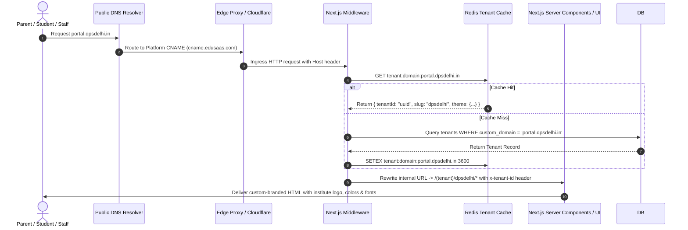

# Multi-Tenancy, Custom Domains & Dynamic Visual Branding Specification

This document details the mechanics of host-based tenant resolution, custom domain DNS verification, automatic SSL provisioning, and dynamic theme/branding token injection.

---

## 1. Domain Resolution Lifecycle



---

## 2. Custom Domain Provisioning & Verification Architecture

When an institute admin connects a custom domain (e.g. `erp.stmarys.ac.in`):

1. **DNS Instructions Displayed to Admin**:
   - Record Type: `CNAME`
   - Host: `erp` (or `@` if apex)
   - Value / Target: `cname.edusaas.com`
   - TTL: `Auto` (or `300`)
2. **Automated Verification Loop**:
   - Admin clicks **"Verify DNS & Issue SSL"**.
   - Server executes DNS lookup using Node.js `dns.promises.resolveCname('erp.stmarys.ac.in')`.
   - If CNAME points to `cname.edusaas.com`:
     - Calls Cloudflare for Platforms API / Let's Encrypt ACME challenge.
     - Sets `tenant_domains.is_verified = true` and `ssl_status = 'ACTIVE'`.
     - Flushes Redis cache key for that domain.
   - If DNS has not propagated:
     - Returns informative status: *"CNAME currently points to old server. Please allow 5-30 minutes for DNS propagation."*

---

## 3. Dynamic Visual Branding & Design Tokens

Every tenant configures their visual identity during onboarding or in General Settings. The Next.js root layout injects these values dynamically:

```tsx
// app/(tenant)/[tenant]/layout.tsx
import { getTenantBranding } from '@/lib/tenant';

export default async function TenantLayout({
  children,
  params,
}: {
  children: React.ReactNode;
  params: { tenant: string };
}) {
  const tenant = await getTenantBranding(params.tenant);

  return (
    <html lang="en" style={{
      // Dynamic CSS Custom Properties injected per tenant
      ['--tenant-primary' as any]: tenant.primary_color,
      ['--tenant-secondary' as any]: tenant.secondary_color,
      ['--tenant-font' as any]: `'${tenant.font_family}', sans-serif`,
    }}>
      <head>
        <link rel="icon" href={tenant.favicon_url || '/default-favicon.png'} />
        <link rel="stylesheet" href={`https://fonts.googleapis.com/css2?family=${encodeURIComponent(tenant.font_family)}:wght@400;500;600;700;800&display=swap`} />
        <title>{tenant.name} | Education Portal</title>
      </head>
      <body className="font-[family-name:var(--tenant-font)] bg-slate-50 text-slate-900">
        {children}
      </body>
    </html>
  );
}
```

---

## 4. White-Labeled Transactional Templates (Email, SMS & WhatsApp)

Every tenant can customize their communication templates using dynamic interpolation placeholders:

| Variable | Description | Example Output |
| :--- | :--- | :--- |
| `{{institute_name}}` | Full legal name of school/college | Delhi Public School, R.K. Puram |
| `{{student_name}}` | Full name of student | Aarav Sharma |
| `{{admission_no}}` | Student ID or PRN | DPS/2026/0491 |
| `{{due_amount}}` | Pending invoice balance | ₹15,000 |
| `{{due_date}}` | Due date in local format | 10th November 2026 |
| `{{payment_url}}` | Direct 1-click payment link | `https://dps.edusaas.com/pay/inv_0491` |
| `{{portal_url}}` | Tenant custom portal URL | `https://portal.dpsdelhi.in` |
