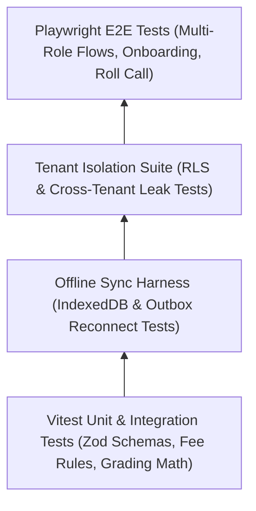

# Comprehensive Quality Assurance & Testing Strategy

This document details the multi-tiered testing strategy, automated test suites, multi-tenant isolation verification, and offline-sync test harnesses.

---

## 1. Testing Pyramid & Tooling Stack



| Layer | Tool | Purpose | Target Coverage |
| :--- | :--- | :--- | :--- |
| **Unit & Math** | **Vitest** | Fee concession logic, late fine calculation, CBSE/SGPA grading engines. | > 90% |
| **Offline Sync** | **Fake IndexedDB + Vitest** | Simulates network drops, outbox queuing, and batch sync reconciliations. | 100% Core Flows |
| **Tenant Isolation** | **Vitest + Postgres** | Validates that queries executed under Tenant A never return Tenant B records. | 100% Critical Entities |
| **End-to-End (E2E)**| **Playwright** | Complete user journeys (Onboarding wizard, Cashier POS checkout, Roll call). | Critical Path Coverage |

---

## 2. Dedicated Multi-Tenant Isolation Test Harness

Every new data model added to the schema must pass the tenant isolation assertion suite:

```typescript
// tests/tenant-isolation.test.ts
import { describe, it, expect, beforeEach } from 'vitest';
import { prisma, getTenantPrisma } from '@/lib/prisma';

describe('Multi-Tenant Isolation Assurance', () => {
  let tenantAId: string;
  let tenantBId: string;

  beforeEach(async () => {
    // 1. Seed two distinct tenants
    const tenantA = await prisma.tenant.create({ data: { name: 'School A', slug: 'school-a' } });
    const tenantB = await prisma.tenant.create({ data: { name: 'School B', slug: 'school-b' } });
    tenantAId = tenantA.id;
    tenantBId = tenantB.id;

    // 2. Insert records into Tenant A
    const dbA = getTenantPrisma(tenantAId);
    await dbA.student.create({
      data: { admission_no: 'A-001', first_name: 'Rahul', last_name: 'Dravid', dob: new Date() }
    });
  });

  it('Tenant B client must NEVER see Tenant A students', async () => {
    const dbB = getTenantPrisma(tenantBId);
    const students = await dbB.student.findMany();
    expect(students.length).toBe(0);
  });

  it('Direct query without tenant_id should be blocked by RLS in production', async () => {
    // Assert RLS rejects un-scoped context
    const scopedDb = getTenantPrisma(tenantBId);
    const result = await scopedDb.student.findFirst({ where: { admission_no: 'A-001' } });
    expect(result).toBeNull();
  });
});
```

---

## 3. Offline-First Sync Test Harness

```typescript
// tests/offline-sync.test.ts
import { describe, it, expect } from 'vitest';
import { offlineDb, processOutbox } from '@/lib/offline';

describe('Offline Attendance Sync Flow', () => {
  it('Queues attendance mutation offline and clears upon successful sync', async () => {
    // 1. Simulate offline mutation
    const mutationId = 'test-mutation-uuid';
    await offlineDb.sync_outbox.add({
      id: mutationId,
      endpoint: '/api/sync/outbox',
      method: 'POST',
      payload: { section_id: 'sec-1', date: '2026-10-27', records: [] },
      created_at: Date.now(),
      retry_count: 0
    });

    expect(await offlineDb.sync_outbox.count()).toBe(1);

    // 2. Mock online event & trigger sync
    await processOutbox();

    // 3. Outbox queue should be empty after successful transmission
    expect(await offlineDb.sync_outbox.count()).toBe(0);
  });
});
```
