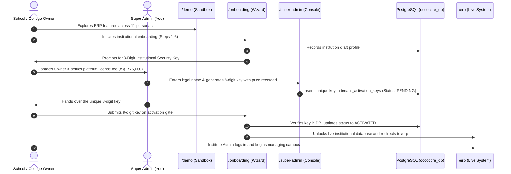

# Core Platform: Enterprise 3-Tier Architecture & Business Model Specification
> **Document Code**: DOC-ARCH-2026-CORE · Version 2.0 · Production Specification

---

## 1. Executive Summary & Platform Hierarchy

The Core Educational Operating System is structured as a **3-Tier Enterprise Application**, separating the SaaS software owner from individual institutions and sales evaluation:

```
                               ┌──────────────────────────────────────────────────────────┐
                               │                 CORE PLATFORM ECOSYSTEM                  │
                               └────────────────────────────┬─────────────────────────────┘
                                                            │
                 ┌──────────────────────────────────────────┼──────────────────────────────────────────┐
                 │                                          │                                          │
                 ▼                                          ▼                                          ▼
   ┌───────────────────────────┐              ┌───────────────────────────┐              ┌───────────────────────────┐
   │         TIER 1            │              │          TIER 2           │              │          TIER 3           │
   │  SUPER ADMIN APP (/app)   │              │   MULTI-TENANT ERP APP    │              │   DEMO SALES SANDBOX      │
   │      /super-admin         │              │           /erp            │              │           /demo           │
   └─────────────┬─────────────┘              └─────────────┬─────────────┘              └─────────────┬─────────────┘
                 │                                          │                                          │
    Platform Business Owner Only                Institutional Clients                      Prospective Buyers & Leads
    (You: OCCO / Core Owner)                    (Schools, Colleges, Academies)             (Self-service feature trial)
```

---

## 2. Platform Roles & Authority Matrix

| Role Scope | Entity | Primary Actor | URL Route | Core Responsibilities |
|---|---|---|---|---|
| **Tier 1: Root** | **Platform Super Admin** | **Software Platform Owner (You)** | `/super-admin/*` | • Central management of all institutes.<br>• Issue unique 8-digit activation keys.<br>• Monetize and charge license fees per institute.<br>• Manage custom on-premise build requests.<br>• Suspend / Activate tenants.<br>• System health & audit telemetry. |
| **Tier 2: Tenant** | **Institute Administrator** | **Campus Owner / Trustee / Director** | `/erp/*` or `/admin/*` | • Full administrative authority over campus.<br>• Manage campus admissions, academics, fee ledgers.<br>• Configure campus branding, logo, colors.<br>• Assign roles & PINs to faculty and staff.<br>• **Zero access to Super Admin or license keys.** |
| **Tier 2: Campus** | **Principal / College Admin** | **Academic Executive** | `/erp/*` | • Daily roll call, timetables, and academic operations.<br>• NEP credit banks, hall tickets, exam broasheets. |
| **Tier 2: Campus** | **Faculty / Teacher** | **Classroom Educator** | `/erp/*` | • Roll call attendance, test marks entry, student feedback. |
| **Tier 2: Campus** | **Bursar / Accountant** | **Finance Officer** | `/erp/*` | • POS collection counter, Dynamic UPI QR reconciliation. |
| **Tier 2: User** | **Student & Parent** | **End Users** | `/student/*` & `/parent/*` | • Admit cards, fee receipt download, live GPS bus tracker. |
| **Tier 3: Sandbox** | **Prospective Buyer** | **Guest Evaluator** | `/demo/*` | • Read-only feature simulation with fake sample data.<br>• Switch between 11 personas without database access. |

---

## 3. The 3 Directory Scopes & Modular Design

### A. Tier 1: Super Admin (`/app/super-admin/`)
* **Purpose**: Private root console for the business owner.
* **Authentication**: Isolated 3-tier auth (`email` + `password` + `4-digit Master Security PIN: 9999`).
* **Session**: Dedicated HMAC-SHA256 signed HTTP-only cookie (`core_superadmin_token`).
* **Route Protection**: Strict Edge Middleware guard (`middleware.ts`). Unauthenticated requests are immediately bounced to `/super-admin/login`.
* **Database Tables**:
  - `super_admin_users`: Platform credentials.
  - `tenant_activation_keys`: Unique 8-digit keys with custom amounts charged (₹).
  - `custom_build_requests`: On-premise enterprise installation leads for universities.

### B. Tier 2: Institutional ERP (`/app/erp/` and `/app/admin/`)
* **Purpose**: Production ERP for paying schools, colleges, and coaching academies.
* **Tenant Isolation**: Every database query is strictly parameterized with `tenant_id` from verified session context. School A never receives School B's records.
* **Code Extractability**: The `/app/erp/` directory is architected as an independent module. When a university contracts for a **dedicated on-premise build**, this directory and its dependencies can be exported as a standalone bundle and deployed directly onto client campus server racks.

### C. Tier 3: Demo Sandbox (`/app/demo/`)
* **Purpose**: Instant, frictionless feature trial for prospective institutional clients.
* **Architecture**: 100% hardcoded mock state (`lib/demo/demoMockData.ts`).
* **Safety**: Zero PostgreSQL mutations. Changes made in demo sessions stay in browser memory and cannot alter the live multi-tenant database.
* **Persona Simulation**: 11 authentic institutional personas (Institute Admin, College Admin, Principal, HOD, Faculty, Admission Officer, Accountant, HR Manager, Librarian, Student, Parent).

---

## 4. End-to-End Monetization & Onboarding Lifecycle



---

## 5. Dedicated On-Premise Custom Builds Flow
When a large university or coaching chain requests a dedicated installation running on their own private campus servers:
1. Inbound inquiry is captured into `custom_build_requests` table.
2. In `/super-admin`, Super Admin reviews student count, server rack specs, and sets a custom quote (e.g. ₹15,00,000).
3. The standalone `/app/erp` codebase is packaged and provisioned on the client's internal servers.

